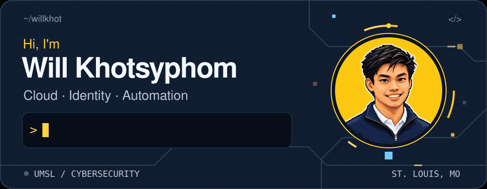

<!-- Upload this README and the assets folder together to willkhot/willkhot. -->
<picture>
  <source media="(prefers-reduced-motion: reduce)" srcset="assets/hero-still.png">
  
</picture>

  <a href="https://www.linkedin.com/in/will-khotsyphom"><strong>LinkedIn ↗</strong></a> &nbsp;·&nbsp;
  <a href="https://github.com/willkhot/linux-cloud-iam-labs"><strong>Explore my labs ↗</strong></a>

## A little about me

I'm really interested in **cloud security** and **identity and access management (IAM)**. I'm always building, breaking, and learning something new in Azure and Entra ID, and this is where I share it.

- ☁️ **Azure Fundamentals (AZ-900)** certified
- 🔐 Pursuing **Identity and Access Administrator (SC-300)**
- 🛡️ Focused on **cloud security, IAM, and Zero Trust**

## My toolbox

  
  
  
  
  
  
  

##

